# Extra dates — a walkthrough

A night added to a repeating gathering by hand: the Saturday Christmas party of a Friday
group, a makeup Wednesday after a snow week, the nursery on Christmas Eve. It belongs to the
gathering — its regulars, its history, its access list, its labels — and it never changes the
schedule. The design and its review are in
[docs/proposals/extra-nights.md](../../proposals/extra-nights.md).

Every frame is the real app against a seeded emulator, captured by
`e2e/extra-dates-walkthrough.spec.ts`, which also asserts that the Fridays around the party
stay Fridays at 7pm. Regenerate with:

```bash
WALKTHROUGH=1 TZ=America/Los_Angeles npx playwright test --project=chromium-desktop \
  e2e/extra-dates-walkthrough.spec.ts
npx tsx scripts/build-extra-dates-walkthrough.ts
```

## J9 — the Christmas party

On a Tuesday, a core leader adds the Saturday Christmas party to Friday Fellowship. Every write here goes through the real editor, the security rules and the calendar projection.

### Any night of the gathering offers it

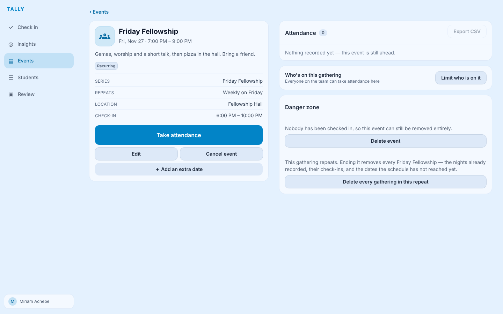

Friday Fellowship’s next night, still the schedule speaking. Under Edit and Cancel sits one new quiet action: add an extra date. It is offered from any ordinary night of a repeating gathering, to the people who could already edit it.

### Pre-filled from the gathering, nothing about repeating

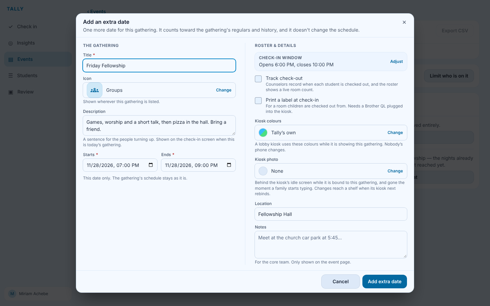

The form opens as Friday Fellowship: title, icon, location, check-in window, labels and kiosk look carried across. There is no Type and no Repeats, and the dates read Starts / Ends rather than Next start — “This date only. The gathering’s schedule stays as it is.”

### Saturday afternoon, two till five

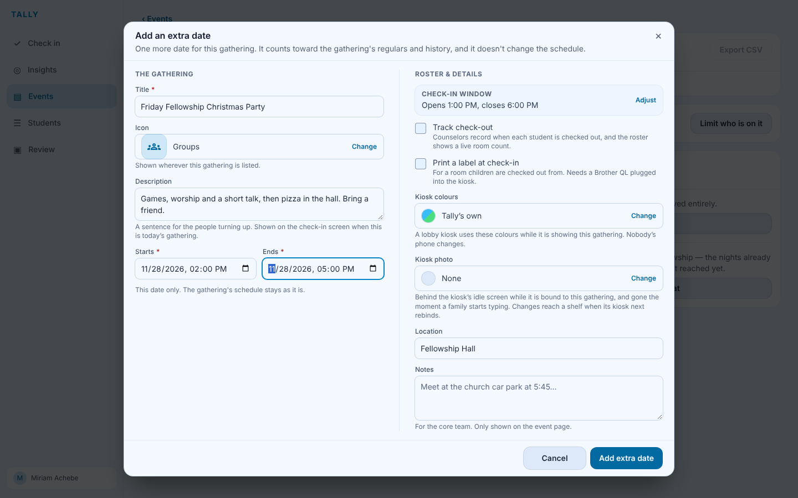

The leader renames it and moves it to the Saturday afternoon. Changing the start carries the end along, so the gathering keeps its length while the date is being chosen.

### Its own page, tagged Extra date

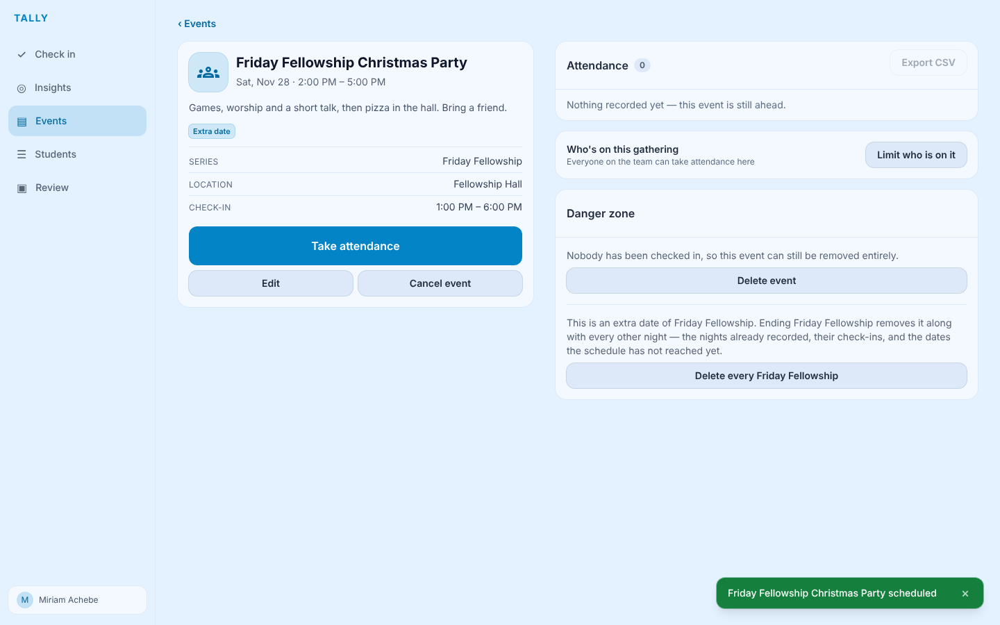

The party has a page like any night: take attendance, edit, cancel. Where a Friday says Recurring, this says Extra date, and there is no Repeats row because it does not.

## J9e — getting it wrong

An extra date can be edited, cancelled or deleted like any night. Ending the whole gathering is still possible from it, but it has to be asked for by name.

### Deleting one night comes first

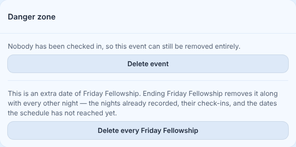

The danger zone on an extra date. Deleting this one night is first. Ending the whole gathering is still possible from here, but the button names it — “Delete every Friday Fellowship Christmas Party” — so it cannot be mistaken for removing the party.

## J9 — the Christmas party

On a Tuesday, a core leader adds the Saturday Christmas party to Friday Fellowship. Every write here goes through the real editor, the security rules and the calendar projection.

### The calendar: one extra, every Friday where it was

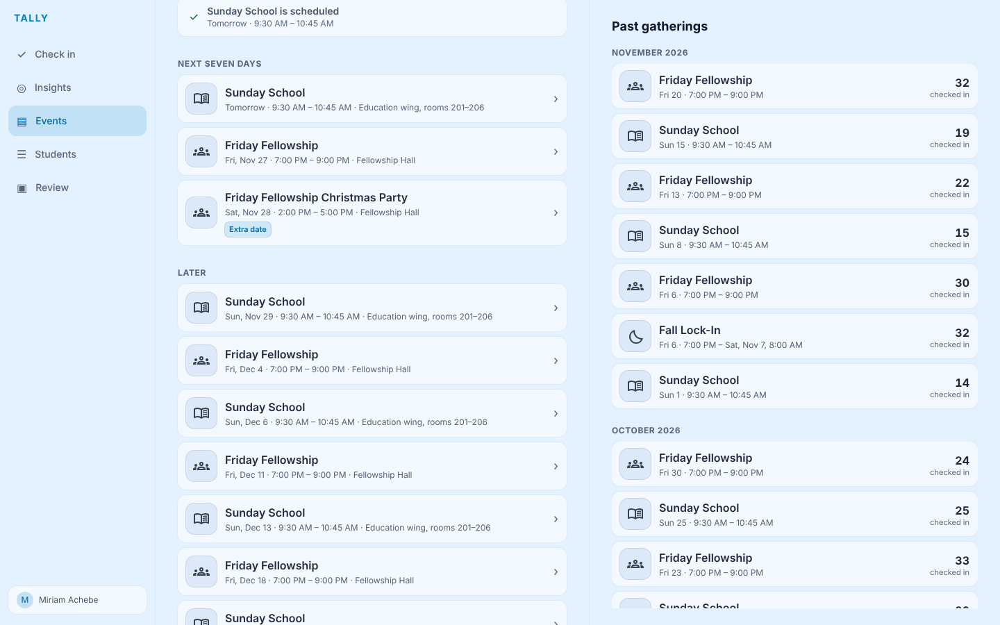

Back on the Events tab, the Saturday party sits between two Fridays with its tag. The Fridays around it are untouched — same day, same 7pm. A party that became the schedule’s template would have turned every one of them into a Saturday afternoon.

## J9g — the gathering changes later

An extra date keeps the settings it was created with. The gathering’s own editor says so before a change is saved.

### Editing Friday names the extras it will not reach

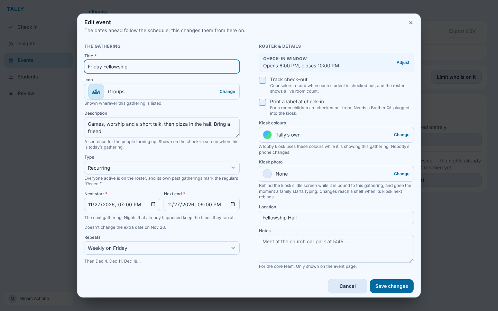

An extra date keeps what it was created with, like any night already written down. So the gathering’s own editor says so before anything is saved: “Doesn’t change the extra date on …”. A label template changed in December will not surprise anybody at the party.

## J9h — where the leader starts

A leader who starts from New event and picks One-off is pointed at an extra date when the title names a gathering already on the calendar.

### A one-off that names a gathering is pointed at it

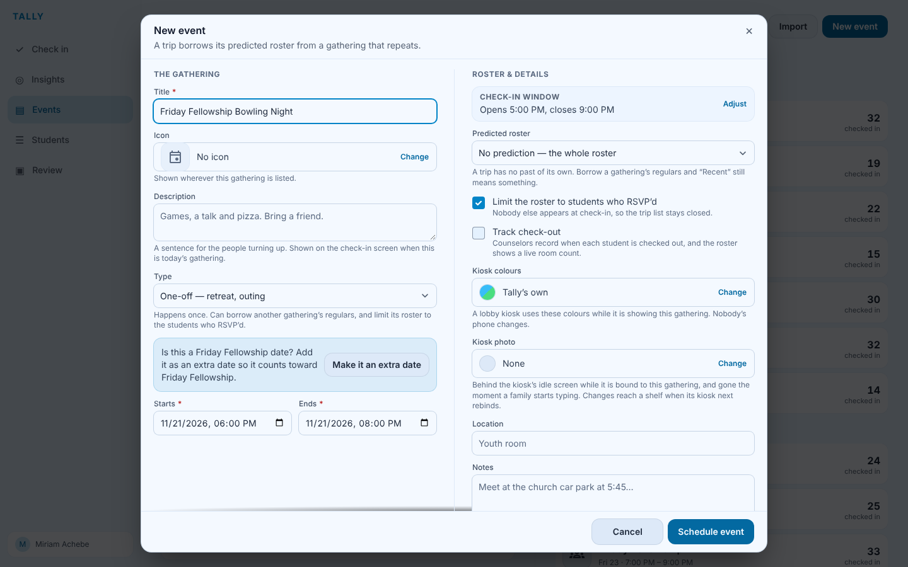

Most leaders will not start from the gathering’s page. They tap New event, choose One-off and type the name. The form notices the gathering in the title and offers, in one line, to make it an extra date instead — so the bowling night counts toward Friday.

### One tap later, it is an extra date

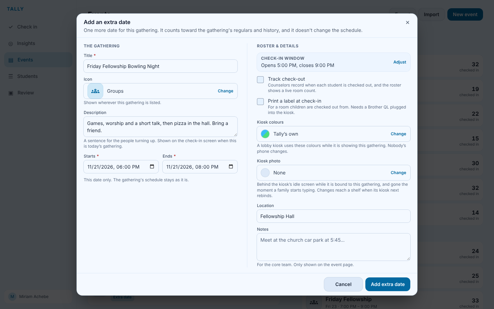

The leader’s own title and dates are kept. The chain link, description, labels, kiosk look and check-out come across from Friday Fellowship, the RSVP list a trip would have had goes, and the Type and Repeats questions disappear.

## J9 — at the door

Tonight, a counselor at the door. The extra date is on the chooser and opens onto Friday Fellowship’s own regulars.

### The chooser says why it is there

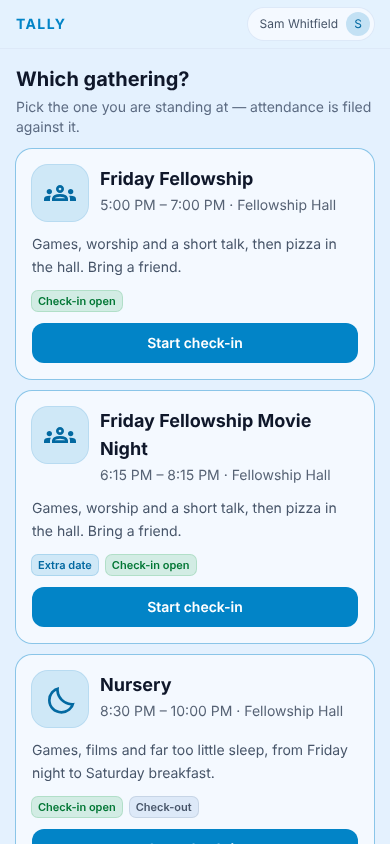

A counselor opens Tally. Tonight’s movie night is on the chooser as a Friday Fellowship card with Extra date first among its chips, so a Friday gathering on another night reads as intended rather than as a mistake.

### Friday’s regulars, ready to tap

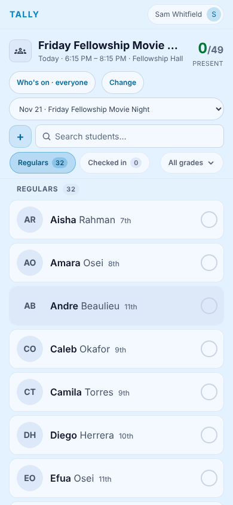

The roster opens on Regulars with Friday Fellowship’s own — the extra date reads the chain’s history like any Friday does. Every tap here lands in Friday Fellowship’s register, and the party will never cost a regular a place on this list by being skipped.
